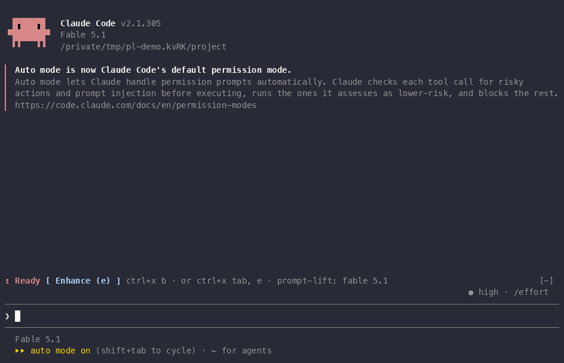

# prompt-lift

A Claude Code mod that turns a vague prompt into a specific one before you send it. One press, one model call, rewritten from the `CLAUDE.md` and rules files your session loaded; the inserted words are highlighted in the prompt box, the cost sits on the band, and nothing is sent until you press Send.




<sub>Full film with sound: <a href="https://github.com/sairam0424/claude-prompt-lift/releases/download/v0.4.0/prompt-lift-0.4.0-launch.mp4">MP4 on the v0.4.0 release</a>.</sub>

The band row sits above the prompt and shows where the last press stands: `Enhance (e)` when idle, `Cancel (c)` while a call runs, then `Send (s)` and `Undo (u)` (`Redo (u)` after an Undo) beside the result's cost (see The band, under Using it). Nothing runs while idle: no timers, no per-keystroke hooks.

## Install

```
/plugin install prompt-lift --marketplace sairam0424/claude-prompt-lift
```

Claude Code asks `y` to add the marketplace, then a scope (`user` makes it available in every project). From a shell: `claude plugin marketplace add sairam0424/claude-prompt-lift && claude plugin install prompt-lift@claude-prompt-lift`. From a clone, add the folder as the marketplace instead; the plugin is read live, so edits show up after `/reload-plugins`.

First run: `/reload-plugins`, then `/prompt-lift probe` (one line per model; `ok` means your account can call it). If a model shows `refused`, set `models` to the rungs you have (see Configuration).

## Using it

Three ways to press Enhance:
- `ctrl+x b` from the prompt
- `ctrl+x tab` to focus the band, then `e`
- `/prompt-lift <your text>`

**Send vs Enter.** Both send what is in the box. Send refuses drafts with `@file` mentions or pasted images (`press Enter to send; @files and images only travel with Enter`) because a plugin-submitted prompt does not expand them.

**Undo.** The original is kept until you submit or `/clear`. Undo acts only when the box still holds the enhanced text (or is empty); otherwise it asks for a second press within 10 s. Undo is two-way (Redo).

### The band

The row leads with a headline (one glyph and a state word, in bold), then the Buttons, then the details in dim text. These are the rows as the mod draws them at a width that fits them (the done row needs about 150 columns whole; narrower terminals cut its details from the right), on a chain pinned to full model ids (an alias chain on Bedrock or Vertex is unpriced, so the dollars read `$? · (no price)`; see Cost):

| State | Row |
|-------|-----|
| Idle | `↥ Ready [ Enhance (e) ] ctrl+x b · or ctrl+x tab, e · prompt-lift: fable 5.1` |
| Enhancing | `↻ Enhancing 1 of 3 [ Cancel (c) ] fable 5.1 › sonnet 5.5 › haiku 5.5` |
| Done | `✓ Enhanced $0.03 [ Enhance (e) ] [ Send (s) ] [ Undo (u) ] fable 5.1 · 1 of 3 · 2.3s · 6.8k cached · 1.4k in · 310 out · +12 words · 1 skill` |
| Kept as is, after a call | `✗ Kept as is [ Enhance (e) ] already specific, left as is · $0.03` |
| Kept as is, before any call | `✗ Kept as is [ Enhance (e) ] session cap $0.10 reached · /prompt-lift cap off` |
| Undo on a box you edited | `↶ Undo? [ Enhance (e) ] [ Send (s) ] [ Undo (u) ] box edited since Enhance · press Undo again to discard it` |
| Undone | `↶ Restored [ Enhance (e) ] [ Send (s) ] [ Redo (u) ] restored your draft` |

**Glyph and colour.** One glyph per state, one cell wide and never an emoji: `↥` ready, `↻` enhancing, `✓` enhanced, `↶` restored or undo, `✗` kept as is, failed or cancelled. The glyph and its word take a key from your theme (`claude` for `Ready`, `success` for `Enhanced`, `error` for `Failed`, `warning` for the rest), never a fixed colour, so they follow a light or dark theme; the primary Button is the state's main action (Enhance when idle, Cancel while enhancing, Send once there is a result).

**While enhancing.** The counter is the rung running of the chain's length, and the strip names every rung: one that failed is struck through and dim, the one running now is bold in the headline's colour, the rest wait in dim text. The chain advances only when a rung fails, so a strip that has moved on means the rung before it failed. The done row then says which rung answered (`1 of 3`) and how long the press took.

**Kept as is, failed, cancelled.** A press that ends without a rewrite leaves its reason in the row, under `✗ Kept as is`, `✗ Failed` or `✗ Cancelled`, until your next action: a press, Enter, any `/prompt-lift` command, a new session or the Undo button. Nothing times it out, and the toast appears as before. The reason ends with what the press cost only when it called a model: `$0.03` for a priced call, `$0.000` for one that cost nothing, `$? · (no price)` for a model without a price; a press that stopped before any call (a guard, a spend cap, no models configured) shows its reason alone. The Buttons stay the phase's own, so a refusal after a result keeps Send and Undo.

**Width.** The row stays on one line and narrows from the least needed part: under 100 columns the idle row drops its key hint (`ctrl+x b · or ctrl+x tab, e`); under 80 the done row drops the elapsed time and the three token figures, and the strip shows the running rung alone; under 60 the headline keeps its glyph and drops its word (`↻ 2/3`, `✓ $0.03`). What still does not fit is cut at the end of the details; the headline is never cut.

### Commands

- `/prompt-lift <text>` — enhance the text
- `/prompt-lift undo` — restore the original draft
- `/prompt-lift model <id|alias|reset>` — put a model first for this machine (`sonnet`, `haiku`, a full id) or `reset` to the configured chain
- `/prompt-lift cap <usd|off>` — cap this session's spend at `<usd>` (`off` lifts it); `cap` alone prints the caps. See Spend caps under Cost
- `/prompt-lift tail <on|off|count>` — control the conversation tail for this session; `tail` alone prints the state
- `/prompt-lift preview <draft>` — print what a press would send: the dynamic block, plus the static block's size and hash (no model call by the mod, no state change; the printed text joins the transcript, so it is capped at 2,000 characters)
- `/prompt-lift status` — the chain, the last call, session and per-day totals, the caps, the engine's session total, the static block size and hash
- `/prompt-lift diff` — word-level diff of the last enhancement
- `/prompt-lift probe` — one tiny call per model in the chain, reporting `ok` or the refusal

A sub-word is recognised only when it is the whole argument (any case): `/prompt-lift diff the two configs and explain` is a draft to enhance, not the diff. `model`, `cap` and `tail` take exactly one token; `model the auth flow as a state machine` is a draft too. `preview` takes the rest as the draft, so a draft that itself begins with the word `preview` can never be enhanced through the command: start it another way or use the button.

### Keyboard

The band buttons take hotkeys only while the band has focus. Press `ctrl+x tab` to focus the band, then `e` for Enhance, `s` for Send, `u` for Undo, or `c` for Cancel.

From the prompt (without focusing the band first), `ctrl+x b` presses Enhance because the Enhance button carries the engine action `app:cycleDiffBase`. This chord works while the diff panel is closed; with the panel open, it cycles the diff base as the action normally does.

A single-key binding is possible through Claude Code's own keybindings file, `~/.claude/keybindings.json` (the `/keybindings` command creates it; changes apply without a restart). Add this block inside the top-level `bindings` array:

```json
{
  "context": "Global",
  "bindings": {
    "ctrl+e": "app:cycleDiffBase"
  }
}
```

This binds ctrl+e to the same action, which presses Enhance whenever the band is drawn. With the band hidden or the diff panel open, ctrl+e cycles the diff base. Pick a key no other binding in your file uses.

### Conversation tail

The recent conversation is excluded by default (`includeConversation: false`). `/prompt-lift tail on|off|<N>` controls it for this session (1-50 messages, each cut to 600 characters); the idle and done rows show ` · tail N` while it is on, and `status` prints `conversation: off` or `conversation: last N messages`. The tail travels in the uncached block, so each press pays for it.

## Data handling

Outbound data leaves this machine only through `$.model.complete`, called with your own Claude Code model access (Bedrock, API key, or subscription, whichever the session uses). The call carries:

- Your draft
- The instruction files the session loaded: Project, Local, Managed, and `~/.claude/rules/*`. Not the auto-memory index. Not `~/.claude/CLAUDE.md` or `~/CLAUDE.md` by default.
- The skill names Claude lists (minus `skillExclude`)
- Up to eight matched skill descriptions
- A named subproject's `CLAUDE.md` when the draft mentions a top-level directory of the project that has one, unless `instructionExclude` matches it
- The recent conversation only when `includeConversation` is on

The mod touches the filesystem through `$.fs.read`, `$.fs.list` and `$.fs.exists`: `$.fs.read` reads those instruction files and a named subproject's `CLAUDE.md`; `$.fs.list` lists the top-level entries of the project root; `$.fs.exists` checks for that `CLAUDE.md` and, after a rewrite, probes any file-looking path the rewrite names that your draft and your `extraRules` did not (the path guard behind `named a file that does not exist`), absolute paths included. The model picks those paths; only existence is read, and the answer never leaves the machine. `$.env.get` reads only `HOME`. Session facts come from `$.session.usage`, `$.session.messages`, `$.session.model`, `$.session.root`, and `$.command.list`.

Writes happen through `$.prompt.fill` (which writes the prompt box) and `$.prompt.submit` (which sends only when you press Send; Enter is the engine's own path). Nothing is sent on a timer or while you type.

Persistence is local to this machine: `$.state` holds the session's held pair, phase, last usage, model choice, the static block's hash and size, session cap override, tail override, and `lastVerdict` (why the last press ended without a rewrite, kept for the band's row until your next action; session only, never written to the store); `$.store` holds one day row per session (`spend:<day>:<writer>`), summed on read and pruned after seven days, plus the pinned model.

The mod uses no `$.http.fetch`, no `$.process.run`, no clipboard access, no telemetry, no analytics, and no file writes.

Hooks: `session.start`, `session.end`, `classic.SessionStart{clear|resume|fork}` (a passthrough observer that clears the held pair on `/clear`), `prompt.submit` (a passthrough observer that forgets the held pair), `ui.render{AbovePrompt}`, `command.run{prompt-lift}`.

## Configuration

Settings live in `/config` under `pluginConfigs` → `prompt-lift@claude-prompt-lift` → `options`, or in your settings file:

```json
{
  "pluginConfigs": {
    "prompt-lift@claude-prompt-lift": {
      "options": {
        "minWords": 4,
        "skillExclude": "sparc:*,gws-*"
      }
    }
  }
}
```

| Key | Type | Default | Description |
|-----|------|---------|-------------|
| `models` | string | `fable,sonnet,haiku` | Comma-separated models to try in order: an alias (`fable`, `sonnet`, `haiku`), a full model id, or `session` for the session's model; on Bedrock/Vertex pin full ids for prices |
| `effortModels` | string | `fable,sonnet` | Models that accept the effort parameter; they are sent effort: low |
| `maxTokens` | number | 2000 | Maximum tokens per model completion |
| `timeoutMsFirst` | number | 30000 | Timeout for the first model attempt |
| `timeoutMsNext` | number | 15000 | Timeout for fallback model attempts |
| `minWords` | number | 3 | Minimum word count to trigger enhancement |
| `maxDraftChars` | number | 4000 | Maximum characters in the draft prompt |
| `keptShareFloor` | number | 0.5 | Minimum fraction of the draft's words the rewrite must keep |
| `maxGrowthChars` | number | 1200 | Maximum character growth allowed |
| `relevantSkills` | number | 8 | Number of relevant skill descriptions to include |
| `instructionFileMaxChars` | number | 40000 | Maximum characters read from each instruction file |
| `enhanceAction` | string | `app:cycleDiffBase` | Engine keybinding action whose chord presses Enhance from the prompt (empty disables) |
| `filePrefix` | string | `plain` | How file paths appear in the rewrite (`plain` or `at`) |
| `skillPlacement` | string | `mention` | How a matched skill is named (`mention` mid-sentence, or `run` as a leading `/name`) |
| `includeConversation` | boolean | false | Include recent conversation history |
| `conversationMessages` | number | 6 | Number of recent messages to include |
| `skillPrefixAllow` | string | `""` | Skills allowed as a leading `/name` under `run` (empty for none) |
| `instructionExclude` | string | `~/.claude/CLAUDE.md,~/CLAUDE.md` | Instruction files to leave out (globs, `~` expands; also applies to a named subproject's `CLAUDE.md`) |
| `skillExclude` | string | `""` | Skill name patterns left out of the listing (`*` and `?` wildcards); empty sends every skill Claude lists |
| `extraRules` | string | `""` | Project preferences appended to the rewrite rules as rule 11 (max 1,000 characters; tag-like markup is neutralised). See Extra rules |
| `prices` | string | | A JSON **string** (quoted and escaped, not a bare object) mapping a model id fragment to per-1M-token prices, merged over the built-in table; invalid JSON or a malformed entry is ignored with a log line. See Cost for the exact form |
| `sessionCapUsd` | number | 0 | Refuse a press once this session's priced presses reach these dollars; 0 is no cap. `/prompt-lift cap <usd|off>` overrides it for the session. See Spend caps under Cost |
| `dayCapUsd` | number | 0 | Refuse a press once today's priced presses, across sessions on this machine, reach these dollars; 0 is no cap |

The chain falls back on a refused model, an empty reply, a rate limit, a server error and a timeout; never on your Cancel, never on a 400. The toast names every attempt.

### Bedrock users

On Bedrock the aliases resolve to whatever the build maps them to, and `effortModels` is matched by exact id, so pin both keys to your cross-region inference profiles:

```json
{
  "pluginConfigs": {
    "prompt-lift@claude-prompt-lift": {
      "options": {
        "models": "us.anthropic.claude-fable-5-1,us.anthropic.claude-sonnet-5-5,us.anthropic.claude-haiku-5-5",
        "effortModels": "us.anthropic.claude-fable-5-1,us.anthropic.claude-sonnet-5-5"
      }
    }
  }
}
```

These are the ids the cost table below prices and the rungs `/prompt-lift model sonnet` names. Run `/prompt-lift probe` once: a rung your account cannot call is reported as refused.

### Extra rules

`extraRules` appends project preferences to the rewrite rules as rule 11, visible only to the model (max 1,000 characters; tag-like markup is neutralised, which also catches a comparison written as `a < b and c > d` — write comparisons in words or as `<=`/`>=`; changing it rebuilds the cached block once):

```json
"extraRules": "Prefer bun over npm. Use single quotes in TypeScript."
```

## Cost

Prices are USD per 1M tokens, Bedrock `us.*` profiles, verified 2026-10-16:

| Model | Input | Output | Cache Write | Cache Read |
|-------|-------|--------|-------------|------------|
| Fable 5.1 | 11.00 | 55.00 | 13.75 | 0.275 |
| Sonnet 5.5 | 2.20 | 11.00 | 2.75 | 0.11 |
| Haiku 5.5 | 0.11 | 0.55 | 0.1375 | 0.011 |

The table is Bedrock `us.*` cross-region pricing, which is Anthropic's list price plus 10%; on the Anthropic API expect about 10% less. On the Anthropic API an alias (`fable`, `sonnet`, `haiku`) prices as the current generation of its family. On Bedrock and Vertex the engine's alias defaults can lag a generation and the mod cannot see which id an alias called, so an alias rung is unpriced there (`$?`, counted as unpriced, never toward a cap) and `status` says so; pin full ids in `models` (the `pluginConfigs` example under Bedrock users, above) to get the current model and real dollars. A `prices` row keyed exactly `fable`, `sonnet` or `haiku` prices that alias on every platform: it is your own statement of what the alias costs you. An unpriced model shows `$?` and `(no price)`.

The built-in table can be overridden with the `prices` option: a JSON **string** mapping a model id fragment to per-1M-token prices, merged over the built-in rows (`fable-5-1`, `sonnet-5-5`, `haiku-5-5`); invalid JSON leaves the defaults and logs `prompt-lift: prices option ignored: <reason>` once.

```json
"prices": "{\"fable-5-1\": {\"input\": 10, \"output\": 50, \"cacheWrite\": 12.5, \"cacheRead\": 0.25}}"
```

Typical press with defaults (≈7k static tokens, ≈1.5k dynamic, ≈400 out):
- Fable: ≈ $0.13 cold / ≈ $0.04 warm
- Sonnet: ≈ $0.027 / ≈ $0.009
- Haiku: ≈ $0.0015 / ≈ $0.0006

The cache lives 5 minutes. Every toast that follows a model call ends with the call's real dollars (a rewrite, `already specific`, every refusal, a chain that failed after a paid rung), and `status` counts them all. `/prompt-lift model haiku` switches the first rung.

### Spend caps

`sessionCapUsd` caps this session's priced presses (`/prompt-lift cap <usd>` moves it for the session, `cap off` lifts it); `dayCapUsd` caps today's presses across every session on this machine. Both are off (`0`) by default. A press is refused before any model call once the recorded spend meets the cap (`prompt-lift: session cap $0.10 reached · /prompt-lift cap off`), the check reads only the mod's own ledger (an unpriced `$?` press never counts), and while a cap is active the band's rows end with ` · $0.85 left` (`(day)` when the day cap is tighter). `status` prints `caps:` and the engine's `session total (all tools)`. On Bedrock and Vertex an alias chain is unpriced, so the caps count nothing until you pin full ids (Bedrock users, above). While a cap is active over such a chain, the `caps:` line and the rows end with ` · alias rungs not counted`.

## Why was my draft refused?

Each refusal is one toast and leaves the box exactly as typed. The band keeps the reason in its row (`✗ Kept as is`) until your next action, so it is still there to read after the toast has gone.

Before any model call (nothing is spent):

- `prompt-lift: commands and shell lines are sent as typed` — the draft starts with `/`, `!` or `#`. Press Enter: those lines run, they are not prompts.
- `prompt-lift: that reads like an answer to Claude's question` — the draft opens like a reply (`yes`, `no`, `ok`, `sure`, `go ahead`, `option 2`, …) when under 12 words, or is under 12 words right after Claude asked a question. Answer with Enter.
- `prompt-lift: under 3 words, nothing to enhance` — fewer than `minWords` words. Add a few, or lower `minWords`.
- `prompt-lift: over 4000 characters, already specific` — longer than `maxDraftChars`. Send it as it is, or raise the cap.
- `prompt-lift: session cap $0.10 reached · /prompt-lift cap off` — this session's priced presses have reached `sessionCapUsd` (or the cap `/prompt-lift cap` set). `/prompt-lift cap off` lifts it for the session, `/prompt-lift cap 2.50` moves it.
- `prompt-lift: day cap $5.00 reached` — today's priced presses, across sessions, have reached `dayCapUsd`. Raise the option or wait for tomorrow; there is no override.

After the call (the toast ends with what the call cost):

- `reply hit the token cap, kept your prompt` — the rewrite ran to `maxTokens`. Shorten the draft or raise `maxTokens`.
- `the model returned nothing` — an empty rewrite. Press again, or `/prompt-lift model sonnet`.
- `rewrite too long, kept your prompt` — the rewrite is longer than the draft plus max(400, 150 + 3 × draft length) characters, capped by `maxGrowthChars` (1,200), or has more than three sentences beyond the draft. Raise `maxGrowthChars`, or start from a fuller draft.
- `rewrite dropped too much of your prompt, kept it` — fewer than `keptShareFloor` (50%) of your draft's words of four letters or more survived. Lower the floor if you want freer rewrites.
- `changed a question into a task, kept your prompt` / `changed a task into a question, kept your prompt` — the rewrite flipped your intent. Phrase the draft so the question or the instruction is unmistakable.
- `lost a file or code reference from your draft, kept it` — a path, `@mention` or code token from the draft is missing in the rewrite. Press again; the model is told to keep them.
- `added a command or link you did not write, kept your prompt` — the rewrite introduced `rm`, `curl`, `wget`, `sudo` or `chmod`, a pipe to `sh`, `&&`, a URL or an absolute path that appears neither in your draft nor in the instruction files. If you want it, type it yourself.
- `rewrite starts with a command prefix, kept your prompt` — the rewrite begins with `!`, `#` or a `/word` that is not a listed skill (a path such as `/src/auth.ts` included), which Enter would run instead of send.
- `named a file that does not exist, kept your prompt` — the rewrite names a file-looking path (rooted, with an extension, or under a top-level directory of the project) that is not on disk. Prose such as `CI/CD` or `and/or` is not checked.
- `draft changed while enhancing, left as is` — you kept typing. Press Enhance again when the draft is ready.
- `no model answered · fable: rate_limit → sonnet: timeout → haiku: refused` — every rung failed; the trail names each outcome. `/prompt-lift probe` tells you which models your account can call.
- `cancelled, draft unchanged` — you pressed Cancel; no fallback was tried.
- `already specific, left as is` — not a refusal: the model judged the draft fine. The call is still billed.

## Updating

- Installed from GitHub: `claude plugin update prompt-lift@claude-prompt-lift`, then restart Claude Code.
- Installed from a clone: `git pull`, then `/reload-plugins`.
- Coming from 0.3.x (`prompt-master@claude-prompt-master`): follow [docs/UPGRADING.md](docs/UPGRADING.md); the options under the old settings key do not carry over by themselves.
- After updating from 0.4.0 or 0.4.1, restart every open Claude Code session: a 0.4.0 or 0.4.1 session left running keeps writing the old single day row, and its later presses can be lost when an updated session migrates that row.

## Limits

- One band above the prompt, shared by every mod: hooks run in `enabledPlugins` order (earlier = outer). prompt-lift passes the band through and stacks above the mods beneath, but a mod listed *before* it that draws without passing through (the playground `token-weather` does) hides the row. Fix: move `prompt-lift@claude-prompt-lift` above that mod's line, then `/reload-plugins`. The `/prompt-lift …` commands keep working meanwhile.
- Terminal only (no desktop footer, no VS Code); one band row; no timers, so the day figure on the idle row refreshes at the next press after midnight.
- The band changes only on events: a press starting, a rung starting or failing, a result, a refusal, Undo. Nothing animates while a single model call is in flight; the strip advances per rung, so a slow rung shows the same row until it answers or fails.
- The strike-through on a failed rung depends on your terminal: one that draws none shows a failed rung in dim text like a pending one, and the counter (`2 of 3`) still tells you which rung is running.
- Shares your account's model quota with the main turn; a rate limit on the first rung falls back to the next and the toast says so.
- The mod sends instruction file text to the model, so a hostile `CLAUDE.md` in a cloned repository can attempt prompt injection. Tag-like markup is neutralised and the model is told to treat that text as data; the residual risk is yours to weigh in untrusted repositories.

## Development

Tests, type gate, evals and the demo recording script: see [docs/DEVELOPMENT.md](docs/DEVELOPMENT.md). The plugin is read live from its folder; `claude plugin validate .` and `claude plugin test .` are the two gates.

## License

MIT — see [LICENSE](LICENSE). Copyright (c) 2026 Sairam Ugge.
